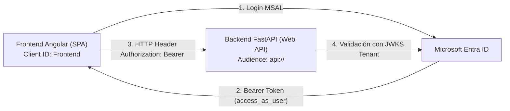

# Manual de Configuración de Recursos en Azure — RRHH Screening Assistant

Este manual describe el paso a paso detallado para aprovisionar y configurar todos los recursos en la nube de **Microsoft Azure** necesarios para el funcionamiento del backend (**LangGraph + Arquitectura Hexagonal**) y el frontend (**Angular + MSAL**) del sistema de reclutamiento y screening técnico.

---

## 📋 Tabla de Contenido
1. [Resumen de Recursos](#1-resumen-de-recursos)
2. [Recurso 1: Azure OpenAI Service](#2-azure-openai-service)
3. [Recurso 2: Azure Cosmos DB NoSQL (Persistencia & Vector Store)](#3-azure-cosmos-db-nosql)
4. [Recurso 3: Azure Blob Storage (Documentos & CVs)](#4-azure-blob-storage)
5. [Recurso 4: Azure AI Document Intelligence (Extracción de Texto)](#5-azure-ai-document-intelligence)
6. [Recurso 5: Azure AI Content Safety (Prompt Shields & Moderación)](#6-azure-ai-content-safety-opcional)
7. [Recurso 6: Microsoft Entra ID (Autenticación OAuth2 / OIDC)](#7-microsoft-entra-id)
8. [Matriz de Variables de Entorno (.env)](#8-matriz-de-variables-de-entorno-env)
9. [Script Rápido con Azure CLI (Automatización Opcional)](#9-script-con-azure-cli)
10. [Checklist de Verificación y Activación](#10-checklist-de-verificación)

---

## 1. Resumen de Recursos

| # | Recurso Azure | Servicio / Tipo | Rol en el Sistema |
|---|---|---|---|
| 1 | **Azure OpenAI** | Cognitive Services | LLM ReAct (`gpt-4o-mini`), Sub-agente Juez y Embeddings (`text-embedding-3-small`) |
| 2 | **Azure Cosmos DB** | API NoSQL | Persistencia de Checkpoints LangGraph, Hilos, Usuarios y **Vector Store Talent Pool** |
| 3 | **Azure Storage Account** | Blob Storage v2 | Almacenamiento seguro de archivos PDF/Word de CVs subidos |
| 4 | **Document Intelligence** | Applied AI Service | Extracción OCR estructurada en formato Markdown (`prebuilt-layout`) |
| 5 | **Content Safety** | Cognitive Services *(Opcional)* | Input Grounding: Detección de Prompt Injection y contenido tóxico |
| 6 | **Microsoft Entra ID** | Azure Active Directory | Autenticación basada en tokens JWT v2 para Frontend SPA y Backend Web API |

---

## 2. Microsoft AI Foundry (anteriormente Azure OpenAI / Azure AI Studio)

Microsoft ha unificado Azure OpenAI y el catálogo de modelos en el portal **Microsoft Azure AI Foundry** (`https://ai.azure.com/`).

El sistema utiliza modelos de lenguaje para el agente ReAct de reclutamiento, el sub-agente auditor de Grounding (Juez) y la generación de vectores para el Talent Pool.

### Pasos de Configuración en Microsoft AI Foundry:
1. Accede al portal de **Microsoft AI Foundry**: [https://ai.azure.com/](https://ai.azure.com/) o crea un recurso de tipo **Azure AI Foundry / Cognitive Services** en el [Azure Portal](https://portal.azure.com/).
2. Crea un **Proyecto (Project)** dentro de tu Hub (ej. `dipaie-group1`).
3. Ve a la sección **Models + endpoints (Modelos y puntos de conexión)** o **Deployments (Implementaciones)** y despliega **dos modelos**:

#### Implementación 1: Modelo de Chat y Razonamiento (`gpt-5-mini` o `gpt-4o-mini`)
* **Modelo**: `gpt-5-mini` (o `gpt-4o-mini`)
* **Nombre de la implementación (Deployment name)**: `gpt-5-mini`
* **Tipo de implementación**: Standard / Global Standard
* *Nota Técnica:* Los modelos de nueva generación/razonamiento como `gpt-5-mini` operan con `temperature=1.0`. El adaptador backend (`AzureOpenAIProvider`) ajusta automáticamente este parámetro para garantizar compatibilidad total con tool calling y structured outputs.

#### Implementación 2: Modelo de Embeddings Vectoriales
* **Modelo**: `text-embedding-3-small`
* **Nombre de la implementación (Deployment name)**: `text-embedding-3-small`
* **Dimensiones vectoriales**: `1536`

### Claves y Endpoint a obtener:
En el portal de Azure o en Foundry (Overview -> Connected Resources / Endpoints):
* **Endpoint compatible OpenAI**: Utiliza el formato de endpoint base del recurso:
  `AZURE_ENDPOINT=https://<tu-recurso>.openai.azure.com/` (o `https://<tu-recurso>.services.ai.azure.com/`)
  *(Evita incluir sufijos como `/api/projects/...`, ya que el SDK de OpenAI concatena automáticamente las rutas de API).*
* **API Key**: Copia la clave de acceso del recurso conectado.
* `AZURE_DEPLOYMENT=gpt-5-mini`
* `AZURE_OPENAI_EMBEDDING_DEPLOYMENT=text-embedding-3-small`
* `AZURE_OPENAI_API_VERSION=2024-08-01-preview`

---

## 3. Azure Cosmos DB NoSQL

Cosmos DB NoSQL es el núcleo de persistencia: guarda el estado conversacional mediante LangGraph Checkpoints y actúa como base de datos vectorial para el Talent Pool de candidatos.

### Paso 3.1: Crear la Cuenta de Cosmos DB
1. En Azure Portal, busca **Azure Cosmos DB** y selecciona **Crear**.
2. Elige la opción **Azure Cosmos DB for NoSQL**.
3. Configura:
   * **Nombre de la cuenta**: ej. `cosmos-rrhh-prod`
   * **Capacidad**: Provisioned throughput o Serverless (Serverless es ideal para entornos de desarrollo/pruebas).
4. Pulsa **Revisar y crear**.

### Paso 3.2: ⚠️ HABILITAR FEATURES PREVIEW (Crítico para Búsqueda Vectorial)
Para que Cosmos DB soporte búsquedas por similitud de cosenos (`diskANN`) y búsqueda híbrida:
1. Ve al menú lateral de tu cuenta de Cosmos DB -> sección **Settings (Configuración)** -> **Features (Características)**.
2. Localiza y habilita las siguientes opciones:
   * ✅ **Vector Search for NoSQL API** (Pulsa *Enable*).
   * ✅ **Full Text & Hybrid Search for NoSQL API** (Pulsa *Enable* si está disponible en tu región).
> *Nota: La activación de la característica suele tomar entre 5 a 15 minutos en propagarse en Azure.*

### Paso 3.3: Crear la Base de Datos
1. Ve al **Data Explorer** en tu cuenta de Cosmos DB.
2. Pulsa **New Database** (Nueva base de datos).
3. **Database id**: `rrhh`
4. Pulsa **OK**.

### Paso 3.4: Crear los Contenedores
Crea los siguientes **5 contenedores** en la base de datos `rrhh`. Es fundamental respetar las claves de partición exactas:

| Contenedor | Partition Key | Descripción / Requisito |
|---|---|---|
| `checkpoints` | `/partition_key` | **Obligatorio para LangGraph** (`CosmosDBSaverSync` de `langchain-azure-cosmosdb`). |
| `threads` | `/userId` | Hilos de conversación del usuario/reclutador. |
| `users` | `/id` | Datos y roles del usuario autenticado vía Entra ID. |
| `files` | `/ownerId` | Metadatos y texto extraído de CVs subidos. |
| `candidates` | `/recruiterId` | Talent Pool con vector search (ver política abajo). |

#### Configuración Vectorial del Contenedor `candidates`:
Al crear el contenedor `candidates` desde el portal o mediante script, define la política vectorial:
* **Container id**: `candidates`
* **Partition key**: `/recruiterId`
* **Vector Embedding Policy**:
```json
{
  "vectorEmbeddings": [
    {
      "path": "/embedding",
      "dataType": "float32",
      "distanceFunction": "cosine",
      "dimensions": 1536
    }
  ]
}
```
* **Indexing Policy (Política de Indexación)**:
```json
{
  "indexingMode": "consistent",
  "includedPaths": [
    { "path": "/*" }
  ],
  "excludedPaths": [
    { "path": "/\"_etag\"/?" }
  ],
  "vectorIndexes": [
    { "path": "/embedding", "type": "diskANN" }
  ]
}
```
> *Tip:* Si dejas las credenciales en el archivo `.env`, el backend inicializa automáticamente estos contenedores y políticas al arrancar (`CosmosDBManager._init_database_and_containers`).

### Claves y Endpoint a obtener:
En el menú de Cosmos DB -> **Keys (Claves)**:
* `COSMOS_ENDPOINT`: `https://<tu-cuenta-cosmos>.documents.azure.com:443/`
* `COSMOS_KEY`: `Primary Key`
* `COSMOS_DATABASE_NAME`: `rrhh`

---

## 4. Azure Blob Storage

Almacena de manera inmutable los archivos binarios de CVs subidos por los reclutadores (PDF, DOCX).

### Pasos de Configuración:
1. En Azure Portal, busca **Storage accounts (Cuentas de almacenamiento)** y pulsa **Crear**.
2. Configuración básica:
   * **Nombre**: ej. `storerrhhprod` (solo letras minúsculas y números).
   * **Rendimiento**: Standard.
   * **Redundancia**: Locally-redundant storage (LRS) para desarrollo o ZRS para producción.
3. Pulsa **Revisar y crear**.
4. Una vez creado, ve al recurso -> menú lateral **Data storage (Almacenamiento de datos)** -> **Containers (Contenedores)**.
5. Pulsa **+ Container**:
   * **Name**: `rrhh-documents`
   * **Anonymous access level**: `Private (no anonymous access)`
   * Pulsa **Create**.
6. *(Opcional)* Si requieres acceso desde el navegador, en **CORS** (bajo Configuración):
   * Allowed origins: `http://localhost:4200` (y tu dominio frontend).
   * Allowed methods: `GET, PUT, POST, OPTIONS, HEAD`.
   * Allowed headers: `*`.

### Claves a obtener:
En el menú de la Storage Account -> **Access keys (Claves de acceso)**:
* Copia el **Connection string** de la `key1` para `AZURE_STORAGE_CONNECTION_STRING`.
* `AZURE_STORAGE_ACCOUNT_NAME`: `<nombre-de-cuenta>`
* `AZURE_STORAGE_ACCOUNT_KEY`: Copia la clave `Key 1`.
* `AZURE_STORAGE_CONTAINER_NAME`: `rrhh-documents`

---

## 5. Azure AI Document Intelligence

Encargado de la extracción multimodal y OCR de documentos PDF y Word. Transforma el diseño de los CVs en Markdown estructurado, preservando tablas y encabezados.

### Pasos de Configuración:
1. En Azure Portal, busca **Document Intelligence** (anteriormente Form Recognizer) y pulsa **Crear**.
2. Configuración:
   * **Nombre**: ej. `docintel-rrhh-prod`
   * **Nivel de precios**: `Free F0` (para desarrollo, 500 páginas/mes) o `Standard S0`.
3. Pulsa **Revisar y crear**.
4. Ve al recurso -> **Keys and Endpoint**:
   * Copia el **Endpoint** (`https://<tu-recurso>.cognitiveservices.azure.com/`).
   * Copia la **Key 1**.

El código utiliza automáticamente el modelo preentrenado `prebuilt-layout` con formato `DocumentContentFormat.MARKDOWN`.

---

## 6. Azure AI Content Safety (Opcional)

Proporciona la capa de **Input Grounding**, analizando el texto del usuario y de los CVs para bloquear inyecciones de comandos (Prompt Shields) o contenido dañino.

### Pasos de Configuración:
1. En Azure Portal, busca **Content Safety** y pulsa **Crear**.
2. Asigna un nombre (ej. `safety-rrhh-prod`) y nivel de precios (`Standard S0` o `Free F0`).
3. Ve a **Keys and Endpoint**:
   * `CONTENT_SAFETY_ENDPOINT`: `https://<tu-recurso>.cognitiveservices.azure.com/`
   * `CONTENT_SAFETY_KEY`: Copia la `Key 1`.
4. Si decides activarlo, cambia en tu `.env`: `SAFETY_PROVIDER=azure`.

---

## 7. Microsoft Entra ID

La autenticación se basa en OAuth2 / OpenID Connect con dos registros de aplicaciones (App Registrations): uno para el **Backend Web API** y otro para el **Frontend SPA**.



### 7.1 Registro del Backend: Web API (`rrhh-assistance-api`)
1. Ve a **Microsoft Entra ID** en Azure Portal -> **App registrations (Registros de aplicaciones)** -> **New registration (Nuevo registro)**.
2. Nombre: `rrhh-assistance-api`.
3. Tipos de cuenta admitidos: *Accounts in this organizational directory only* (Single tenant).
4. Pulsa **Register (Registrar)**.
5. Copia el **Application (client) ID** y el **Directory (tenant) ID**.

#### Configurar el Scope (Ámbito):
6. En el menú de la aplicación -> **Expose an API (Exponer una API)**:
   * Junto a *Application ID URI*, pulsa **Add** o **Set**. Azure sugerirá `api://<backend-client-id>`. Pulsa **Save**.
   * Pulsa **+ Add a scope (Agregar un ámbito)**:
     * **Scope name**: `access_as_user`
     * **Who can consent?**: `Admins and users`
     * **Admin consent display name**: Acceso a la API de Asistencia de RRHH
     * **Admin consent description**: Permite a la aplicación acceder a los servicios de RRHH en nombre del usuario firmado.
     * **State**: Enabled
     * Pulsa **Add scope**.

#### Configurar Roles de Aplicación (App Roles):
7. En el menú de la aplicación -> **App roles (Roles de la aplicación)** -> **Create app role**:
   * **Display name**: `Recruiter`
   * **Allowed member types**: `Users/Groups`
   * **Value**: `Recruiter`
   * **Description**: Reclutador con acceso a filtrado y candidatos.
   * Pulsa **Apply**.
   *(Opcional: Repetir para el rol `Admin`).*

---

### 7.2 Registro del Frontend: SPA (`rrhh-assistance-spa`)
1. En **App registrations**, pulsa **New registration**.
2. Nombre: `rrhh-assistance-spa`.
3. Selecciona *Single-page application (SPA)* en Redirect URI:
   * URI: `http://localhost:4200`
4. Pulsa **Register**.
5. Copia el **Application (client) ID** del frontend.

#### Otorgar Permisos a la API del Backend:
6. En el menú de la aplicación del Frontend -> **API permissions (Permisos de API)** -> **Add a permission (Agregar un permiso)**.
7. Ve a la pestaña **APIs my organization uses (API que usa mi organización)** y busca `rrhh-assistance-api`.
8. Selecciona **Delegated permissions (Permisos delegados)** y marca:
   * ✅ `access_as_user`
9. Pulsa **Add permissions**.
10. Pulsa **Grant admin consent for <tu-organización>** (Conceder consentimiento de administrador).

---

## 8. Matriz de Variables de Entorno (.env)

Una vez que tengas los recursos creados, actualiza tu archivo `.env` en la raíz del proyecto backend:

```bash
# ==============================================================================
# PROVEEDORES ACTIVOS EN NUBE AZURE
# ==============================================================================
ENVIRONMENT=production
LLM_PROVIDER=azure_openai
JUDGE_LLM_PROVIDER=azure_openai
EMBEDDING_PROVIDER=azure_openai
STORAGE_PROVIDER=blob
PERSISTENCE_PROVIDER=cosmos
EXTRACTOR_PROVIDER=document_intelligence
SAFETY_PROVIDER=noop            # Cambiar a "azure" si creaste Content Safety
AUTH_PROVIDER=entra_id          # Cambiar a "entra_id" para producción

# 1. AZURE OPENAI
AZURE_ENDPOINT=https://<tu-recurso>.openai.azure.com/
AZURE_API_KEY=<tu-api-key-openai>
AZURE_DEPLOYMENT=gpt-4o-mini
AZURE_OPENAI_EMBEDDING_DEPLOYMENT=text-embedding-3-small
AZURE_OPENAI_API_VERSION=2024-08-01-preview

# 2. AZURE COSMOS DB
COSMOS_ENDPOINT=https://<tu-cuenta-cosmos>.documents.azure.com:443/
COSMOS_KEY=<tu-primary-key-cosmos>
COSMOS_DATABASE_NAME=rrhh
COSMOS_CHECKPOINTS_CONTAINER=checkpoints
COSMOS_THREADS_CONTAINER=threads
COSMOS_USERS_CONTAINER=users
COSMOS_CANDIDATES_CONTAINER=candidates
COSMOS_FILES_CONTAINER=files

# 3. AZURE BLOB STORAGE
AZURE_STORAGE_CONNECTION_STRING=DefaultEndpointsProtocol=https;AccountName=<tu-storage>;AccountKey=<tu-key>;EndpointSuffix=core.windows.net
AZURE_STORAGE_ACCOUNT_NAME=<tu-storage>
AZURE_STORAGE_ACCOUNT_KEY=<tu-key>
AZURE_STORAGE_CONTAINER_NAME=rrhh-documents

# 4. AZURE AI DOCUMENT INTELLIGENCE
DOCUMENT_INTELLIGENCE_ENDPOINT=https://<tu-recurso>.cognitiveservices.azure.com/
DOCUMENT_INTELLIGENCE_KEY=<tu-key-document-intelligence>

# 5. AZURE AI CONTENT SAFETY (Si aplica)
CONTENT_SAFETY_ENDPOINT=https://<tu-recurso>.cognitiveservices.azure.com/
CONTENT_SAFETY_KEY=<tu-key-content-safety>

# 6. MICROSOFT ENTRA ID (BACKEND)
ENTRA_TENANT_ID=<tu-directory-tenant-id>
ENTRA_CLIENT_ID=<client-id-de-rrhh-assistance-api>
ENTRA_AUDIENCE=api://<client-id-de-rrhh-assistance-api>
```

### Configuración del Frontend (`src/environments/environment.ts`):
```typescript
export const environment = {
  production: true,
  apiBaseUrl: 'http://localhost:5000', // O tu URL de producción en Azure
  azureAd: {
    clientId: '<client-id-de-rrhh-assistance-spa>',
    tenantId: '<tu-directory-tenant-id>',
    redirectUri: 'http://localhost:4200',
    scopes: ['api://<client-id-de-rrhh-assistance-api>/access_as_user'],
  },
  useDevAuth: false, // false activa la autenticación real con Microsoft Entra ID
};
```

---

## 9. Script con Azure CLI

Si prefieres automatizar la creación de los recursos mediante la terminal, ejecuta el siguiente script en PowerShell o Bash (requiere `az login` previo):

```bash
# Variables generales
RESOURCE_GROUP="rg-rrhh-assistance-prod"
LOCATION="eastus"

# 1. Crear Grupo de Recursos
az group create --name $RESOURCE_GROUP --location $LOCATION

# 2. Crear Storage Account y Contenedor Blob
az storage account create \
  --name storerrhhprod$RANDOM \
  --resource-group $RESOURCE_GROUP \
  --location $LOCATION \
  --sku Standard_LRS \
  --kind StorageV2

# 3. Crear Cosmos DB NoSQL Account
az cosmosdb create \
  --name cosmos-rrhh-$RANDOM \
  --resource-group $RESOURCE_GROUP \
  --default-consistency-level Session \
  --capabilities EnableServerless

# 4. Crear Azure Document Intelligence
az cognitiveservices account create \
  --name docintel-rrhh-$RANDOM \
  --resource-group $RESOURCE_GROUP \
  --kind FormRecognizer \
  --sku S0 \
  --location $LOCATION \
  --yes

# 5. Crear Azure OpenAI
az cognitiveservices account create \
  --name aoai-rrhh-$RANDOM \
  --resource-group $RESOURCE_GROUP \
  --kind OpenAI \
  --sku S0 \
  --location $LOCATION \
  --yes
```

---

## 10. Checklist de Verificación

Antes de dar el pase a producción, verifica los siguientes puntos:

- [ ] **Cosmos DB**: Las características *Vector Search for NoSQL API* y *Full Text & Hybrid Search* están en estado **Enabled**.
- [ ] **Contenedores de Cosmos DB**: El contenedor `checkpoints` tiene como partition key `/partition_key` y `candidates` tiene `/recruiterId`.
- [ ] **Azure OpenAI**: Existen dos despliegues activos llamados exactamente `gpt-4o-mini` y `text-embedding-3-small`.
- [ ] **Blob Storage**: El contenedor `rrhh-documents` existe y tiene acceso privado.
- [ ] **Document Intelligence**: Las credenciales responden al modelo `prebuilt-layout`.
- [ ] **Entra ID**: El frontend tiene concedido el consentimiento de administrador para el scope `api://.../access_as_user`.
- [ ] **Prueba de Conexión**: Ejecuta `pytest tests/` en el backend para validar que no haya conflictos de sintaxis o dependencias.
