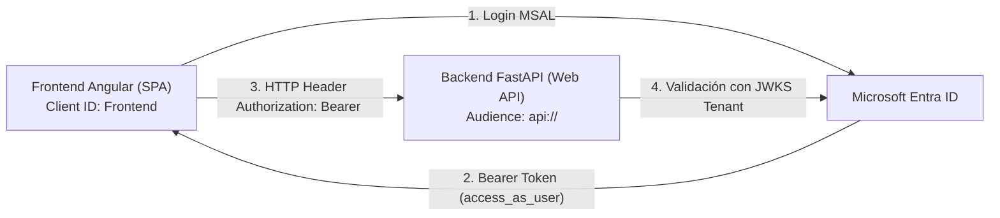
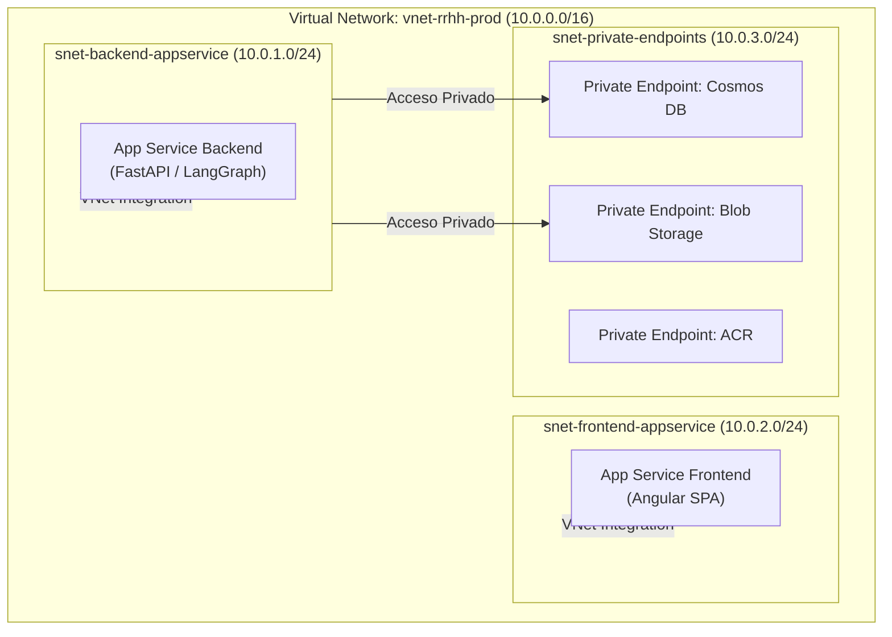

# Manual de Configuración de Recursos en Azure — RRHH Screening Assistant

Este manual describe el paso a paso detallado para aprovisionar y configurar todos los recursos en la nube de **Microsoft Azure** necesarios para el funcionamiento del backend (**LangGraph + Arquitectura Hexagonal**) y el frontend (**Angular + MSAL**) del sistema de reclutamiento y screening técnico.

---
L
## 📋 Tabla de Contenido
1. [Resumen de Recursos](#1-resumen-de-recursos)
2. [Recurso 1: Microsoft AI Foundry (LLM & Embeddings)](#2-microsoft-ai-foundry-anteriormente-azure-openai--azure-ai-studio)
3. [Recurso 2: Azure Cosmos DB NoSQL (Persistencia & Vector Store)](#3-azure-cosmos-db-nosql)
4. [Recurso 3: Azure Blob Storage (Documentos & CVs)](#4-azure-blob-storage)
5. [Recurso 4: Azure AI Document Intelligence (Extracción de Texto)](#5-azure-ai-document-intelligence)
6. [Recurso 5: Azure AI Content Safety (Prompt Shields & Moderación)](#6-azure-ai-content-safety-opcional)
7. [Recurso 6: Microsoft Entra ID (Autenticación OAuth2 / OIDC)](#7-microsoft-entra-id)
8. [Recurso 7: Red Virtual (VNet) y Subredes Delegadas (Networking)](#8-red-virtual-vnet-y-subredes-delegadas)
9. [Recurso 8: Azure Container Registry (ACR) para Backend y Frontend](#9-azure-container-registry-acr-para-backend-y-frontend)
10. [Recurso 9: Azure App Service (Hosting de Contenedores Linux)](#10-azure-app-service-hosting-de-contenedores-linux)
11. [Matriz de Variables de Entorno (.env & App Settings)](#11-matriz-de-variables-de-entorno-env)
12. [Script Completo con Azure CLI (Automatización)](#12-script-completo-con-azure-cli)
13. [Checklist de Verificación y Puesta en Marcha](#13-checklist-de-verificación)

---

## 1. Resumen de Recursos

| # | Recurso Azure | Servicio / Tipo | Rol en el Sistema |
|---|---|---|---|
| 1 | **Microsoft AI Foundry** | Cognitive Services | LLM ReAct (`gpt-5-mini`), Sub-agente Juez y Embeddings (`text-embedding-3-small`) |
| 2 | **Azure Cosmos DB** | API NoSQL | Persistencia de Checkpoints LangGraph, Hilos, Usuarios y **Vector Store Talent Pool** |
| 3 | **Azure Storage Account** | Blob Storage v2 | Almacenamiento seguro de archivos PDF/Word de CVs subidos |
| 4 | **Document Intelligence** | Applied AI Service | Extracción OCR estructurada en formato Markdown (`prebuilt-layout`) |
| 5 | **Content Safety** | Cognitive Services *(Opcional)* | Input Grounding: Detección de Prompt Injection y contenido tóxico |
| 6 | **Microsoft Entra ID** | Azure Active Directory | Autenticación basada en tokens JWT v2 para Frontend SPA y Backend Web API |
| 7 | **Virtual Network (VNet)** | Virtual Network & Subnets | Aislamiento de red, subredes delegadas para App Service y endpoints privados |
| 8 | **Container Registry (ACR)** | Container Registry | Registro privado de imágenes Docker para Backend (FastAPI) y Frontend (Angular) |
| 9 | **Azure App Service** | Linux Web App Containers | Hosting elástico de los contenedores de Backend (puerto 5000) y Frontend (puerto 4200/80) |

---

## 2. Microsoft AI Foundry (anteriormente Azure OpenAI / Azure AI Studio)

Microsoft ha unificado Azure OpenAI y el catálogo de modelos en el portal **Microsoft Azure AI Foundry** (`https://ai.azure.com/`).

El sistema utiliza modelos de lenguaje para el agente ReAct de reclutamiento, el sub-agente auditor de Grounding (Juez) y la generación de vectores para el Talent Pool.

### Pasos de Configuración en Microsoft AI Foundry:
1. Accede al portal de **Microsoft AI Foundry**: [https://ai.azure.com/](https://ai.azure.com/) o crea un recurso de tipo **Azure AI Foundry / Cognitive Services** en el [Azure Portal](https://portal.azure.com/).
2. Crea un **Proyecto (Project)** dentro de tu Hub (ej. `dipaie-group1`).
3. Ve a la sección **Models + endpoints (Modelos y puntos de conexión)** o **Deployments (Implementaciones)** y despliega **dos modelos**:

#### Implementación 1: Modelo de Chat y Razonamiento (`gpt-5-mini` o `gpt-4o-mini`)
* **Modelo**: `gpt-5-mini` (o `gpt-4o-mini`)
* **Nombre de la implementación (Deployment name)**: `gpt-5-mini`
* **Tipo de implementación**: Standard / Global Standard
* *Nota Técnica:* Los modelos de nueva generación/razonamiento como `gpt-5-mini` operan con `temperature=1.0`. El adaptador backend (`AzureOpenAIProvider`) ajusta automáticamente este parámetro para garantizar compatibilidad total con tool calling y structured outputs.

#### Implementación 2: Modelo de Embeddings Vectoriales
* **Modelo**: `text-embedding-3-small`
* **Nombre de la implementación (Deployment name)**: `text-embedding-3-small`
* **Dimensiones vectoriales**: `1536`

### Claves y Endpoint a obtener:
En el portal de Azure o en Foundry (Overview -> Connected Resources / Endpoints):
* **Endpoint compatible OpenAI**: Utiliza el formato de endpoint base del recurso:
  `AZURE_ENDPOINT=https://<tu-recurso>.openai.azure.com/` (o `https://<tu-recurso>.services.ai.azure.com/`)
  *(Evita incluir sufijos como `/api/projects/...`, ya que el SDK de OpenAI concatena automáticamente las rutas de API).*
* **API Key**: Copia la clave de acceso del recurso conectado.
* `AZURE_DEPLOYMENT=gpt-5-mini`
* `AZURE_OPENAI_EMBEDDING_DEPLOYMENT=text-embedding-3-small`
* `AZURE_OPENAI_API_VERSION=2024-08-01-preview`

---

## 3. Azure Cosmos DB NoSQL

Cosmos DB NoSQL es el núcleo de persistencia: guarda el estado conversacional mediante LangGraph Checkpoints y actúa como base de datos vectorial para el Talent Pool de candidatos.

### Paso 3.1: Crear la Cuenta de Cosmos DB
1. En Azure Portal, busca **Azure Cosmos DB** y selecciona **Crear**.
2. Elige la opción **Azure Cosmos DB for NoSQL**.
3. Configura:
   * **Nombre de la cuenta**: ej. `cosmos-rrhh-prod`
   * **Capacidad**: Provisioned throughput o Serverless (Serverless es ideal para entornos de desarrollo/pruebas).
4. Pulsa **Revisar y crear**.

### Paso 3.2: ⚠️ HABILITAR FEATURES PREVIEW (Crítico para Búsqueda Vectorial)
Para que Cosmos DB soporte búsquedas por similitud de cosenos (`diskANN`) y búsqueda híbrida:
1. Ve al menú lateral de tu cuenta de Cosmos DB -> sección **Settings (Configuración)** -> **Features (Características)**.
2. Localiza y habilita las siguientes opciones:
   * ✅ **Vector Search for NoSQL API** (Pulsa *Enable*).
   * ✅ **Full Text & Hybrid Search for NoSQL API** (Pulsa *Enable* si está disponible en tu región).
> *Nota: La activación de la característica suele tomar entre 5 a 15 minutos en propagarse en Azure.*

### Paso 3.3: Crear la Base de Datos
1. Ve al **Data Explorer** en tu cuenta de Cosmos DB.
2. Pulsa **New Database** (Nueva base de datos).
3. **Database id**: `rrhh`
4. Pulsa **OK**.

### Paso 3.4: Crear los Contenedores
Crea los siguientes **5 contenedores** en la base de datos `rrhh`. Es fundamental respetar las claves de partición exactas:

| Contenedor | Partition Key | Descripción / Requisito |
|---|---|---|
| `checkpoints` | `/partition_key` | **Obligatorio para LangGraph** (`CosmosDBSaverSync` de `langchain-azure-cosmosdb`). |
| `threads` | `/userId` | Hilos de conversación del usuario/reclutador. |
| `users` | `/id` | Datos y roles del usuario autenticado vía Entra ID. |
| `files` | `/ownerId` | Metadatos y texto extraído de CVs subidos. |
| `candidates` | `/recruiterId` | Talent Pool con vector search (ver política abajo). |

#### Configuración Vectorial del Contenedor `candidates`:
Al crear el contenedor `candidates` desde el portal o mediante script, define la política vectorial:
* **Container id**: `candidates`
* **Partition key**: `/recruiterId`
* **Vector Embedding Policy**:
```json
{
  "vectorEmbeddings": [
    {
      "path": "/embedding",
      "dataType": "float32",
      "distanceFunction": "cosine",
      "dimensions": 1536
    }
  ]
}
```
* **Indexing Policy (Política de Indexación)**:
```json
{
  "indexingMode": "consistent",
  "includedPaths": [
    { "path": "/*" }
  ],
  "excludedPaths": [
    { "path": "/\"_etag\"/?" }
  ],
  "vectorIndexes": [
    { "path": "/embedding", "type": "diskANN" }
  ]
}
```
> *Tip:* Si dejas las credenciales en el archivo `.env`, el backend inicializa automáticamente estos contenedores y políticas al arrancar (`CosmosDBManager._init_database_and_containers`).

### Claves y Endpoint a obtener:
En el menú de Cosmos DB -> **Keys (Claves)**:
* `COSMOS_ENDPOINT`: `https://<tu-cuenta-cosmos>.documents.azure.com:443/`
* `COSMOS_KEY`: `Primary Key`
* `COSMOS_DATABASE_NAME`: `rrhh`

---

## 4. Azure Blob Storage

Almacena de manera inmutable los archivos binarios de CVs subidos por los reclutadores (PDF, DOCX).

### Pasos de Configuración:
1. En Azure Portal, busca **Storage accounts (Cuentas de almacenamiento)** y pulsa **Crear**.
2. Configuración básica:
   * **Nombre**: ej. `storerrhhprod` (solo letras minúsculas y números).
   * **Rendimiento**: Standard.
   * **Redundancia**: Locally-redundant storage (LRS) para desarrollo o ZRS para producción.
3. Pulsa **Revisar y crear**.
4. Una vez creado, ve al recurso -> menú lateral **Data storage (Almacenamiento de datos)** -> **Containers (Contenedores)**.
5. Pulsa **+ Container**:
   * **Name**: `rrhh-documents`
   * **Anonymous access level**: `Private (no anonymous access)`
   * Pulsa **Create**.
6. *(Opcional)* Si requieres acceso desde el navegador, en **CORS** (bajo Configuración):
   * Allowed origins: `http://localhost:4200` (y tu dominio frontend).
   * Allowed methods: `GET, PUT, POST, OPTIONS, HEAD`.
   * Allowed headers: `*`.

### Claves a obtener:
En el menú de la Storage Account -> **Access keys (Claves de acceso)**:
* Copia el **Connection string** de la `key1` para `AZURE_STORAGE_CONNECTION_STRING`.
* `AZURE_STORAGE_ACCOUNT_NAME`: `<nombre-de-cuenta>`
* `AZURE_STORAGE_ACCOUNT_KEY`: Copia la clave `Key 1`.
* `AZURE_STORAGE_CONTAINER_NAME`: `rrhh-documents`

---

## 5. Azure AI Document Intelligence

Encargado de la extracción multimodal y OCR de documentos PDF y Word. Transforma el diseño de los CVs en Markdown estructurado, preservando tablas y encabezados.

### Pasos de Configuración:
1. En Azure Portal, busca **Document Intelligence** (anteriormente Form Recognizer) y pulsa **Crear**.
2. Configuración:
   * **Nombre**: ej. `docintel-rrhh-prod`
   * **Nivel de precios**: `Free F0` (para desarrollo, 500 páginas/mes) o `Standard S0`.
3. Pulsa **Revisar y crear**.
4. Ve al recurso -> **Keys and Endpoint**:
   * Copia el **Endpoint** (`https://<tu-recurso>.cognitiveservices.azure.com/`).
   * Copia la **Key 1**.

El código utiliza automáticamente el modelo preentrenado `prebuilt-layout` con formato `DocumentContentFormat.MARKDOWN`.

---

## 6. Azure AI Content Safety (Opcional)

Proporciona la capa de **Input Grounding**, analizando el texto del usuario y de los CVs para bloquear inyecciones de comandos (Prompt Shields) o contenido dañino.

### Pasos de Configuración:
1. En Azure Portal, busca **Content Safety** y pulsa **Crear**.
2. Asigna un nombre (ej. `safety-rrhh-prod`) y nivel de precios (`Standard S0` o `Free F0`).
3. Ve a **Keys and Endpoint**:
   * `CONTENT_SAFETY_ENDPOINT`: `https://<tu-recurso>.cognitiveservices.azure.com/`
   * `CONTENT_SAFETY_KEY`: Copia la `Key 1`.
4. Si decides activarlo, cambia en tu `.env`: `SAFETY_PROVIDER=azure`.

---

## 7. Microsoft Entra ID

La autenticación se basa en OAuth2 / OpenID Connect con dos registros de aplicaciones (App Registrations): uno para el **Backend Web API** y otro para el **Frontend SPA**.



### 7.1 Registro del Backend: Web API (`rrhh-assistance-api`)
1. Ve a **Microsoft Entra ID** en Azure Portal -> **App registrations (Registros de aplicaciones)** -> **New registration (Nuevo registro)**.
2. Nombre: `rrhh-assistance-api`.
3. Tipos de cuenta admitidos: *Accounts in this organizational directory only* (Single tenant).
4. Pulsa **Register (Registrar)**.
5. Copia el **Application (client) ID** y el **Directory (tenant) ID**.

#### Configurar el Scope (Ámbito):
6. En el menú de la aplicación -> **Expose an API (Exponer una API)**:
   * Junto a *Application ID URI*, pulsa **Add** o **Set**. Azure sugerirá `api://<backend-client-id>`. Pulsa **Save**.
   * Pulsa **+ Add a scope (Agregar un ámbito)**:
     * **Scope name**: `access_as_user`
     * **Who can consent?**: `Admins and users`
     * **Admin consent display name**: Acceso a la API de Asistencia de RRHH
     * **Admin consent description**: Permite a la aplicación acceder a los servicios de RRHH en nombre del usuario firmado.
     * **State**: Enabled
     * Pulsa **Add scope**.

#### Configurar Roles de Aplicación (App Roles):
7. En el menú de la aplicación -> **App roles (Roles de la aplicación)** -> **Create app role**:
   * **Display name**: `Recruiter`
   * **Allowed member types**: `Users/Groups`
   * **Value**: `Recruiter`
   * **Description**: Reclutador con acceso a filtrado y candidatos.
   * Pulsa **Apply**.
   *(Opcional: Repetir para el rol `Admin`).*

---

### 7.2 Registro del Frontend: SPA (`rrhh-assistance-spa`)
1. En **App registrations**, pulsa **New registration**.
2. Nombre: `rrhh-assistance-spa`.
3. Selecciona *Single-page application (SPA)* en Redirect URI:
   * URI: `http://localhost:4200`
4. Pulsa **Register**.
5. Copia el **Application (client) ID** del frontend.

#### Otorgar Permisos a la API del Backend:
6. En el menú de la aplicación del Frontend -> **API permissions (Permisos de API)** -> **Add a permission (Agregar un permiso)**.
7. Ve a la pestaña **APIs my organization uses (API que usa mi organización)** y busca `rrhh-assistance-api`.
8. Selecciona **Delegated permissions (Permisos delegados)** y marca:
   * ✅ `access_as_user`
9. Pulsa **Add permissions**.
10. Pulsa **Grant admin consent for <tu-organización>** (Conceder consentimiento de administrador).

---

## 8. Red Virtual (VNet) y Subredes Delegadas (Networking)

Para garantizar la seguridad de la infraestructura y permitir que los servicios de cómputo (**App Service**) se comuniquen de forma privada con los recursos de datos (**Cosmos DB**, **Storage**, **ACR**), se define una **Virtual Network** con subredes especializadas.



### 8.1 Plan de Direccionamiento IP
* **VNet CIDR**: `10.0.0.0/16`
* **Subred Backend**: `snet-backend-appservice` (`10.0.1.0/24`)
  * **Delegación de Subred (Subnet Delegation)**: Obligatoria a `Microsoft.Web/serverFarms`. Permite que la Web App Linux inyecte su tráfico saliente en la VNet.
* **Subred Frontend**: `snet-frontend-appservice` (`10.0.2.0/24`)
  * **Delegación de Subred**: Obligatoria a `Microsoft.Web/serverFarms`.
* **Subred de Endpoints Privados (Opcional)**: `snet-private-endpoints` (`10.0.3.0/24`)
  * Sin delegación. Reservada para tarjetas de red privadas (Private Endpoints) de Cosmos DB, Storage y ACR.

### 8.2 Creación en Azure Portal:
1. En el Azure Portal, busca **Virtual networks (Redes virtuales)** y pulsa **Crear**.
2. **Nombre**: `vnet-rrhh-prod`.
3. Pestaña **Direcciones IP**:
   * Espacio de direcciones IPv4: `10.0.0.0/16`.
   * Pulsa **+ Agregar subred**:
     * **Nombre**: `snet-backend-appservice`
     * **Intervalo de direcciones**: `10.0.1.0/24`
     * **Delegación de subred**: Selecciona **`Microsoft.Web/serverFarms`**.
   * Pulsa **+ Agregar subred**:
     * **Nombre**: `snet-frontend-appservice`
     * **Intervalo de direcciones**: `10.0.2.0/24`
     * **Delegación de subred**: Selecciona **`Microsoft.Web/serverFarms`**.
   * Pulsa **+ Agregar subred**:
     * **Nombre**: `snet-private-endpoints`
     * **Intervalo de direcciones**: `10.0.3.0/24`
     * **Delegación de subred**: `Ninguno`.
4. Pulsa **Revisar y crear**.

---

## 9. Azure Container Registry (ACR) para Backend y Frontend

Azure Container Registry almacena de forma privada las imágenes Docker del **Backend** y del **Frontend**.

### 9.1 Creación del ACR:
1. En Azure Portal, busca **Container registries (Registros de contenedor)** y pulsa **Crear**.
2. Configura:
   * **Nombre del registro**: ej. `acrrhhprod` *(debe ser único globalmente, solo minúsculas y números)*.
   * **Plan de tarifa (SKU)**: `Basic` para desarrollo o `Standard` para producción con replicación y soporte de red.
3. Pulsa **Revisar y crear**.

### 9.2 Repositorios de Imágenes:
El registro almacenará dos imágenes:
1. `rrhh-assistance-backend`: Contenedor Python / FastAPI con la arquitectura hexagonal y LangGraph.
2. `rrhh-assistance-frontend`: Contenedor Node / Angular con la interfaz web.

### 9.3 Compilación y Publicación de Imágenes:

#### Método A: Compilación Directa en la Nube con Azure CLI (Recomendado, no requiere Docker local)
Ejecuta estos comandos en tu terminal:

```bash
# 1. Compilar y subir imagen del Backend
cd rrhh-assistance-backend
az acr build --registry acrrhhprod --image rrhh-assistance-backend:latest -f Dockerfile .

# 2. Compilar y subir imagen del Frontend
cd ../rrhh-assistance-frontend
az acr build --registry acrrhhprod --image rrhh-assistance-frontend:latest -f Dockerfile .
```

#### Método B: Compilación Local con Docker Engine
```bash
# Iniciar sesión en el registro
az acr login --name acrrhhprod

# Backend
cd rrhh-assistance-backend
docker build -t acrrhhprod.azurecr.io/rrhh-assistance-backend:latest .
docker push acrrhhprod.azurecr.io/rrhh-assistance-backend:latest

# Frontend
cd ../rrhh-assistance-frontend
docker build -t acrrhhprod.azurecr.io/rrhh-assistance-frontend:latest .
docker push acrrhhprod.azurecr.io/rrhh-assistance-frontend:latest
```

---

## 10. Azure App Service (Hosting de Contenedores Linux)

Utilizamos **Azure App Service para Contenedores Linux**, lo que permite desplegar directamente las imágenes del ACR con escalabilidad automática, certificados SSL administrados y conexión a la red virtual.

### 10.1 Crear el App Service Plan (Plan de Cómputo):
1. En Azure Portal, busca **App Service plans** y pulsa **Crear**.
2. **Nombre**: `plan-rrhh-prod`.
3. **Sistema operativo**: **Linux**.
4. **Plan de tarifa**: `B1` (Basic - 1 Core, 1.75 GB RAM) o `P1v3` (Producción).
5. Pulsa **Revisar y crear**.

---

### 10.2 Servicio 1: Backend Web App (`app-rrhh-backend`)

#### Creación:
1. Busca **App Services** -> **Crear** -> **Web App**.
2. **Nombre**: `app-rrhh-backend`.
3. **Publicar**: **Contenedor de Docker**.
4. **Sistema operativo**: **Linux**.
5. **Plan de App Service**: Selecciona `plan-rrhh-prod`.
6. Pestaña **Docker**:
   * **Opciones de imagen**: Contenedor único.
   * **Origen de la imagen**: Azure Container Registry.
   * **Registro**: `acrrhhprod`.
   * **Imagen**: `rrhh-assistance-backend`.
   * **Etiqueta**: `latest`.
7. Pulsa **Revisar y crear**.

#### Configuración Crítica del Backend:
* **Puerto del Contenedor**: En la sección **Configuration (Configuración)** -> **Application settings**:
  * Agrega: `WEBSITES_PORT=5000` *(obligatorio, uvicorn escucha en el puerto 5000)*.
* **Autenticación con ACR (Managed Identity)**:
  1. En el menú de la Web App -> **Identity (Identidad)** -> activa el estado **On (Activado)** de la identidad asignada por el sistema y guarda.
  2. En el menú de tu ACR (`acrrhhprod`) -> **Access control (IAM)** -> **Add role assignment**:
     * Rol: **`AcrPull`**
     * Asignar acceso a: **Managed identity (Identidad administrada)** -> selecciona `app-rrhh-backend`.
* **Integración con la Red Virtual (VNet Integration)**:
  1. En el menú de la Web App -> **Networking (Redes)**.
  2. En la sección *Tráfico saliente (Outbound traffic)* -> **Integración con VNet**.
  3. Pulsa **+ Agregar integración de red virtual**.
  4. Selecciona `vnet-rrhh-prod` y la subred **`snet-backend-appservice`**.
  5. Pulsa **Conectar**.

---

### 10.3 Servicio 2: Frontend Web App (`app-rrhh-frontend`)

#### Creación:
1. En **App Services** -> **Crear** -> **Web App**.
2. **Nombre**: `app-rrhh-frontend`.
3. **Publicar**: **Contenedor de Docker**.
4. **Sistema operativo**: **Linux**.
5. **Plan**: `plan-rrhh-prod`.
6. Pestaña **Docker**:
   * **Origen**: Azure Container Registry (`acrrhhprod`).
   * **Imagen**: `rrhh-assistance-frontend`.
   * **Etiqueta**: `latest`.
7. Pulsa **Revisar y crear**.

#### Configuración Crítica del Frontend:
* **Puerto del Contenedor**:
  * En **Application settings** agrega: `WEBSITES_PORT=4200` *(o `80` si usas contenedor con Nginx)*.
* **Permisos ACR**: Asigna la Managed Identity de `app-rrhh-frontend` con el rol **`AcrPull`** sobre el ACR.
* **Integración VNet**: Conéctalo a la subred **`snet-frontend-appservice`**.
* **URL de API Backend**: Asegúrate de que `apiBaseUrl` en el frontend apunte a la URL pública de Azure del backend:
  `https://app-rrhh-backend.azurewebsites.net`.

---

## 11. Matriz de Variables de Entorno (.env & App Settings)

Las siguientes variables deben configurarse en **Application settings** de la Web App del Backend (`app-rrhh-backend`):

```bash
# ==============================================================================
# CONFIGURACIÓN DE AZURE APP SERVICE (BACKEND)
# ==============================================================================
WEBSITES_PORT=5000
PORT=5000
ENVIRONMENT=production
DEBUG=false

# Conmutadores de Arquitectura Hexagonal
LLM_PROVIDER=azure_openai
JUDGE_LLM_PROVIDER=azure_openai
EMBEDDING_PROVIDER=azure_openai
STORAGE_PROVIDER=blob
PERSISTENCE_PROVIDER=cosmos
EXTRACTOR_PROVIDER=document_intelligence
SAFETY_PROVIDER=noop
AUTH_PROVIDER=dev              # Cambiar a "entra_id" con tokens reales

# 1. MICROSOFT AI FOUNDRY (AZURE OPENAI)
AZURE_ENDPOINT=https://<tu-recurso>.openai.azure.com/
AZURE_API_KEY=<tu-api-key-foundry>
AZURE_DEPLOYMENT=gpt-5-mini
AZURE_OPENAI_EMBEDDING_DEPLOYMENT=text-embedding-3-small
AZURE_OPENAI_API_VERSION=2024-08-01-preview

# 2. AZURE COSMOS DB
COSMOS_ENDPOINT=https://<tu-cuenta-cosmos>.documents.azure.com:443/
COSMOS_KEY=<tu-primary-key-cosmos>
COSMOS_DATABASE_NAME=rrhh
COSMOS_CHECKPOINTS_CONTAINER=checkpoints
COSMOS_THREADS_CONTAINER=threads
COSMOS_USERS_CONTAINER=users
COSMOS_CANDIDATES_CONTAINER=candidates
COSMOS_FILES_CONTAINER=files

# 3. AZURE BLOB STORAGE
AZURE_STORAGE_CONNECTION_STRING=DefaultEndpointsProtocol=https;AccountName=<tu-storage>;AccountKey=<tu-key>;EndpointSuffix=core.windows.net
AZURE_STORAGE_ACCOUNT_NAME=<tu-storage>
AZURE_STORAGE_ACCOUNT_KEY=<tu-key>
AZURE_STORAGE_CONTAINER_NAME=rrhh-documents

# 4. AZURE AI DOCUMENT INTELLIGENCE
DOCUMENT_INTELLIGENCE_ENDPOINT=https://<tu-recurso-docintel>.cognitiveservices.azure.com/
DOCUMENT_INTELLIGENCE_KEY=<tu-key-document-intelligence>

# 5. MICROSOFT ENTRA ID (BACKEND)
ENTRA_TENANT_ID=<tu-directory-tenant-id>
ENTRA_CLIENT_ID=<client-id-de-rrhh-assistance-api>
ENTRA_AUDIENCE=api://<client-id-de-rrhh-assistance-api>
```

---

## 12. Script Completo con Azure CLI

Este script aprovisiona de forma automatizada **todos los recursos**, incluyendo la Red Virtual, Subredes con delegación, el Registro de Contenedores y los dos App Services:

```bash
# ==============================================================================
# SCRIPT DE AUTOMATIZACIÓN DE INFRAESTRUCTURA COMPLETA EN AZURE
# ==============================================================================
RESOURCE_GROUP="rg-rrhh-assistance-prod"
LOCATION="eastus"
RAND=$RANDOM

# Nombres de recursos
VNET_NAME="vnet-rrhh-prod"
ACR_NAME="acrrhhprod$RAND"
ASP_NAME="plan-rrhh-prod"
APP_BE_NAME="app-rrhh-backend-$RAND"
APP_FE_NAME="app-rrhh-frontend-$RAND"
STORAGE_NAME="storerrhh$RAND"
COSMOS_NAME="cosmos-rrhh-$RAND"
DOCINTEL_NAME="docintel-rrhh-$RAND"

# 1. Crear Grupo de Recursos
az group create --name $RESOURCE_GROUP --location $LOCATION

# 2. Crear Virtual Network y Subredes Delegadas
az network vnet create \
  --resource-group $RESOURCE_GROUP \
  --name $VNET_NAME \
  --address-prefixes 10.0.0.0/16 \
  --location $LOCATION

# Subred Backend con delegación a App Service
az network vnet subnet create \
  --resource-group $RESOURCE_GROUP \
  --vnet-name $VNET_NAME \
  --name snet-backend-appservice \
  --address-prefixes 10.0.1.0/24 \
  --delegations Microsoft.Web/serverFarms

# Subred Frontend con delegación a App Service
az network vnet subnet create \
  --resource-group $RESOURCE_GROUP \
  --vnet-name $VNET_NAME \
  --name snet-frontend-appservice \
  --address-prefixes 10.0.2.0/24 \
  --delegations Microsoft.Web/serverFarms

# Subred para Private Endpoints
az network vnet subnet create \
  --resource-group $RESOURCE_GROUP \
  --vnet-name $VNET_NAME \
  --name snet-private-endpoints \
  --address-prefixes 10.0.3.0/24

# 3. Crear Azure Container Registry (ACR)
az acr create \
  --resource-group $RESOURCE_GROUP \
  --name $ACR_NAME \
  --sku Basic \
  --admin-enabled true

# 4. Crear Storage Account y Contenedor de Documentos
az storage account create \
  --name $STORAGE_NAME \
  --resource-group $RESOURCE_GROUP \
  --location $LOCATION \
  --sku Standard_LRS \
  --kind StorageV2

STORAGE_KEY=$(az storage account keys list --resource-group $RESOURCE_GROUP --account-name $STORAGE_NAME --query "[0].value" -o tsv)
az storage container create --name rrhh-documents --account-name $STORAGE_NAME --account-key $STORAGE_KEY

# 5. Crear Cosmos DB NoSQL Account
az cosmosdb create \
  --name $COSMOS_NAME \
  --resource-group $RESOURCE_GROUP \
  --default-consistency-level Session \
  --capabilities EnableServerless

# 6. Crear Azure Document Intelligence
az cognitiveservices account create \
  --name $DOCINTEL_NAME \
  --resource-group $RESOURCE_GROUP \
  --kind FormRecognizer \
  --sku S0 \
  --location $LOCATION \
  --yes

# 7. Crear App Service Plan Linux
az appservice plan create \
  --name $ASP_NAME \
  --resource-group $RESOURCE_GROUP \
  --is-linux \
  --sku B1 \
  --location $LOCATION

# 8. Compilar y Subir Imágenes al ACR
cd rrhh-assistance-backend
az acr build --registry $ACR_NAME --image rrhh-assistance-backend:latest -f Dockerfile .
cd ../rrhh-assistance-frontend
az acr build --registry $ACR_NAME --image rrhh-assistance-frontend:latest -f Dockerfile .
cd ..

# 9. Crear Web App del Backend con Integración VNet
az webapp create \
  --resource-group $RESOURCE_GROUP \
  --plan $ASP_NAME \
  --name $APP_BE_NAME \
  --deployment-container-image-name "$ACR_NAME.azurecr.io/rrhh-assistance-backend:latest"

# Configurar puerto y VNet integration del Backend
az webapp config appsettings set --resource-group $RESOURCE_GROUP --name $APP_BE_NAME \
  --settings WEBSITES_PORT=5000 PORT=5000 ENVIRONMENT=production

az webapp vnet-integration add \
  --resource-group $RESOURCE_GROUP \
  --name $APP_BE_NAME \
  --vnet $VNET_NAME \
  --subnet snet-backend-appservice

# 10. Crear Web App del Frontend con Integración VNet
az webapp create \
  --resource-group $RESOURCE_GROUP \
  --plan $ASP_NAME \
  --name $APP_FE_NAME \
  --deployment-container-image-name "$ACR_NAME.azurecr.io/rrhh-assistance-frontend:latest"

az webapp config appsettings set --resource-group $RESOURCE_GROUP --name $APP_FE_NAME \
  --settings WEBSITES_PORT=4200

az webapp vnet-integration add \
  --resource-group $RESOURCE_GROUP \
  --name $APP_FE_NAME \
  --vnet $VNET_NAME \
  --subnet snet-frontend-appservice

# 11. Configurar Acceso de App Service a ACR con Managed Identity
BE_PRINCIPAL_ID=$(az webapp identity assign --resource-group $RESOURCE_GROUP --name $APP_BE_NAME --query principalId -o tsv)
FE_PRINCIPAL_ID=$(az webapp identity assign --resource-group $RESOURCE_GROUP --name $APP_FE_NAME --query principalId -o tsv)
ACR_ID=$(az acr show --name $ACR_NAME --query id -o tsv)

az role assignment create --assignee $BE_PRINCIPAL_ID --scope $ACR_ID --role "AcrPull"
az role assignment create --assignee $FE_PRINCIPAL_ID --scope $ACR_ID --role "AcrPull"

echo "=== INFRAESTRUCTURA DEPOSITADA Y CONFIGURADA EXITOSAMENTE ==="
echo "Backend URL: https://$APP_BE_NAME.azurewebsites.net/docs"
echo "Frontend URL: https://$APP_FE_NAME.azurewebsites.net"
```

---

## 13. Checklist de Verificación y Puesta en Marcha

Antes de dar el pase a producción, verifica los siguientes puntos clave:

- [ ] **Red Virtual (VNet)**: `vnet-rrhh-prod` creada con las subredes `snet-backend-appservice` y `snet-frontend-appservice` delegadas a `Microsoft.Web/serverFarms`.
- [ ] **Container Registry (ACR)**: Las imágenes `rrhh-assistance-backend:latest` y `rrhh-assistance-frontend:latest` están subidas al repositorio.
- [ ] **Managed Identity (AcrPull)**: Ambas Web Apps tienen el rol `AcrPull` asignado sobre el ACR para descargar imágenes sin almacenar contraseñas.
- [ ] **Puerto del Backend**: La Web App del backend tiene configurada la variable `WEBSITES_PORT=5000`.
- [ ] **Puerto del Frontend**: La Web App del frontend tiene configurada la variable `WEBSITES_PORT=4200` (o `80`).
- [ ] **Integración VNet**: Ambas aplicaciones muestran estado **Connected (Conectado)** en la pestaña *Networking -> VNet Integration*.
- [ ] **Cosmos DB**: Las características *Vector Search for NoSQL API* y *Full Text & Hybrid Search* están en estado **Enabled**.
- [ ] **Blob Storage**: El contenedor `rrhh-documents` existe y almacena los CVs subidos.
- [ ] **Document Intelligence**: La API responde con extracción markdown mediante `prebuilt-layout`.
- [ ] **Prueba de Salud**: Visita `https://<tu-app-backend>.azurewebsites.net/docs` para verificar que Swagger cargue correctamente en la nube.

